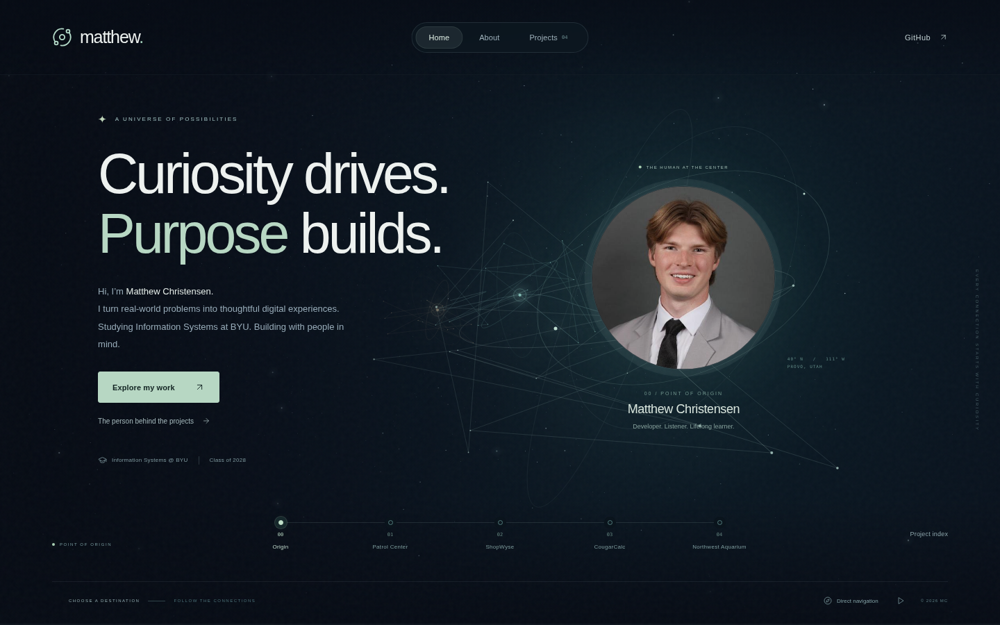

# Technical Portfolio — Matthew Christensen




## Run locally

Requires Node.js 22.12+ or 24+.

```sh
npm ci
npm run dev
```

Open the URL printed by Vite (port 3000 by default).

```sh
npm run build
npm run preview
```

The production build is written to `dist/`. This is a static site: it needs no backend, database, API keys, or access to visitors' accounts.

## Explore

- Scroll to travel along the 3D route; select a destination in the bottom navigation to fly directly to it.
- Home: `#/home`
- About: `#/about`
- Projects: `#/projects`
- Project deep links: `#/projects/patrol-center`, `#/projects/shopwyse`, `#/projects/cougarcalc`, and `#/projects/northwest-aquarium`.
- The project index offers direct access to every destination.
- Left/right arrows and Page Up/Page Down move between destinations when focus is outside a control. Home returns to the origin.
- Ambient motion can be paused. Direct navigation removes camera easing. Reduced-motion preferences enable both by default.

The scene uses Three.js vectors, camera projection, and splines, with Canvas 2D rendering. This preserves spatial depth and camera travel in browsers that do not expose WebGL, including software-only preview environments.

## Content and images

The uploaded **Resume - Matthew Christensen.docx** and Matthew's [GitHub profile](https://github.com/mtchr) are the biographical sources. The uploaded résumé takes precedence over the older résumé website where dates differ. The original résumé document, phone number, and street address are not included in this repository.

- The portrait is the current [mtchr GitHub profile image](https://avatars.githubusercontent.com/u/248929292?v=4), 
- [Patrol Center](https://github.com/mtchr/Traffic-Vehicle-App-): 
- [ShopWyse](https://github.com/mtchr/Shopwyse_Grocery_App): p
- [CougarCalc](https://github.com/mtchr/is404-cougarcalc): 
- [Northwest Aquarium](https://github.com/mtchr/Aquarium-App): 

The three interface images are captures of the public source rendered locally, without signing in, submitting forms, or connecting to live application data. The portfolio never calls the original applications' APIs. External project links open their GitHub repositories.

## Customize

- `src/data.js`: profile, projects, descriptions, technology tags, repository links, and world coordinates.
- `src/main.js`: page content, hash routes, keyboard controls, and journey interactions.
- `src/space.js`: camera path, stars, constellations, and projection renderer.
- `src/style.css`: responsive layout and appearance.
- `public/assets/`: current portrait, project images, architecture illustration, and favicon.


## Verify

With the dev server running:

```sh
npm test
```

The browser suite expects Chromium at `/usr/bin/chromium`. Set `CHROMIUM_PATH` for another installation and `TEST_URL` for a different server URL. It checks navigation and deep links, browser history, project selection, index dialog, keyboard navigation, scroll travel, reduced motion, the current portrait, repository links, and eight desktop/mobile viewport sizes. Temporary screenshots go to the ignored `work/` directory.

## Hosting

Upload the contents of `dist/` to a static host. Relative asset URLs and hash routes support a GitHub Pages repository subpath without server rewrites. This repository does not automatically enable Pages or publish the site.
